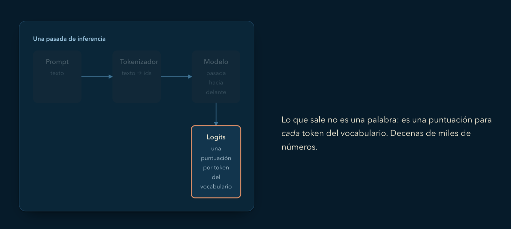
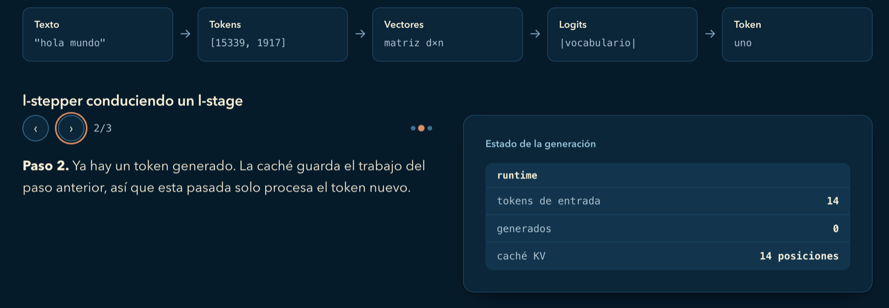
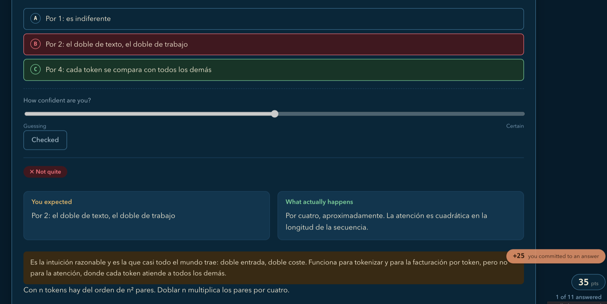

# make-it-learnable

*[Read this in English](README.md)*

**Convierte cualquier material en una lección interactiva que se sostiene sola.**
Apúntalo a un documento, un repo, una función, un paper, una URL o una explicación a
medio hacer, y te devuelve un único fichero HTML: una narrativa guiada por scroll
sobre un diagrama que se transforma, comprobaciones que obligan a mojarse antes de ver
la respuesta, y un final que te dice por dónde volver.

Sin build, sin dependencias, sin red. Abres el fichero, lo mandas por correo, lo
metes en un USB. Dentro de cinco años seguirá funcionando.

El formato es una [explicación explorable](https://en.wikipedia.org/wiki/Explorable_explanation)
— un modelo interactivo de un concepto sostenido por la prosa, donde quien lee dice
qué espera que pase y luego ve cómo la realidad le lleva la contraria. No es un slide
deck con un test pegado al final.

---

## Instalación

**Pruébala primero en un proyecto.** Adjunta `make-it-learnable.zip` y díselo a tu
agente en lenguaje normal:

```
Instala esta skill en este proyecto para poder usarla @make-it-learnable.zip
```

Te la deja dentro del proyecto — `.claude/skills/` en Claude Code, `.agents/skills/` en
otros agentes — y ya la tienes disponible en el siguiente mensaje.

**O lo haces tú**, desde la raíz del proyecto:

```bash
unzip make-it-learnable.zip -d .claude/skills/   # Claude Code
unzip make-it-learnable.zip -d .agents/skills/   # otros agentes
```

Cuando un par de lecciones te hayan convencido, instálala para todos los proyectos:
copia esa misma carpeta `make-it-learnable/` en `~/.claude/skills/` (o
`~/.agents/skills/`). Si te has clonado el repo, la carpeta a copiar es
`skills/make-it-learnable/`.

Requisitos: un agente que pueda escribir archivos y un navegador actual para abrir el
resultado. La skill no trae código que instalar: ni runtime, ni script de build, nada
que compilar ni nada que instalar con `npm`.

## Cómo se usa

Escribe `/make-it-learnable` — sin espacio en el nombre — y detrás, lo que quieras
convertir en lección:

```
/make-it-learnable https://es.wikipedia.org/wiki/Teorema_CAP
/make-it-learnable docs/arquitectura.md
/make-it-learnable src/scheduler.ts — para alguien que acaba de entrar en backend
/make-it-learnable este repo entero, para quien se incorpora el lunes
/make-it-learnable por qué el consenso Raft necesita un líder
```

En ese hueco cabe cualquier cosa: **una URL** (un artículo de Wikipedia, un post, un
RFC), **un fichero**, **una carpeta o la base de código entera**, **un paper o una
transcripción**, o simplemente **un tema** contado con palabras. Si además dices para
quién es, ajusta el nivel a esa persona. Sin ningún argumento te pregunta: no tiene
tema por defecto, y adivinarlo te costaría una lección entera tirada.

A partir de ahí el agente lee el material, decide qué componentes le encajan, escribe
un **blueprint** de la lección, lo revisa y construye a partir de él un único `.html`.
Un idioma que pidas explícitamente tiene prioridad; después manda el idioma de tu
petición y, por último, el de la fuente. Los textos de la interfaz están especificados
en español e inglés, y nunca se entrega una página con mezcla de idiomas.

## Qué pinta tiene

Un escenario que se queda quieto mientras la prosa avanza — el diagrama se transforma
en vez de ser sustituido por otro:



Ese mismo escenario también se puede conducir a mano, paso a paso, viendo cómo cambia
el estado por debajo:



Comprobaciones que obligan a mojarse *antes* de la respuesta, con confianza incluida
— para que el "seguro y equivocado" se vea, en vez de pasar desapercibido:



Y esa es una de siete mecánicas. Ordenar un proceso, reconocer un concepto en código
real y estimar un orden de magnitud son preguntas distintas, y fallan de otra manera.

## Qué construye

Un único `.html`, que respeta el tema claro/oscuro, se usa con teclado y se imprime bien.

Una lección se compone de **secciones**, cada una con un objetivo declarado. Un
**escenario** (stage) sostiene una representación persistente —un diagrama, una traza,
un trozo de estado— y las escenas de una **historia** la transforman a medida que el
lector hace scroll, en vez de cambiar de dibujo cada vez. Las **comprobaciones**
interrumpen en el momento justo y una tarjeta de **cierre** termina la lección diciendo
qué repasar.

### Cómo funciona la skill: blueprint + contratos

La skill **no contiene marcado, ni hoja de estilos, ni script**. A cambio le da al
agente dos cosas:

- **Un formato de blueprint** ([`references/blueprint.md`](skills/make-it-learnable/references/blueprint.md))
  — un plan en YAML de la lección que nombra cada componente, en orden, con todas sus
  entradas: enunciados, respuestas, errores típicos, explicaciones, partes del
  escenario, efectos, fuentes. Ahí se comprueban las referencias cruzadas, antes de
  que exista código.
- **Contratos de componente** ([`components.md`](skills/make-it-learnable/references/components.md),
  [`checks.md`](skills/make-it-learnable/references/checks.md),
  [`runtime.md`](skills/make-it-learnable/references/runtime.md)) — para cada pieza,
  para qué sirve, qué recibe, cómo se comporta (números, umbrales, textos, teclado) y
  qué tiene que cumplirse al entregarla.

El agente escribe la página a su manera a partir de esas dos cosas. Dos lecciones
pueden no parecerse en nada por dentro y tienen que comportarse igual por fuera.

### El vocabulario

Los componentes, agrupados por lo que hacen. Dos son modos narrativos y eliges uno por
tramo de la lección: `Story` mantiene un objeto en pantalla y lo transforma escena a
escena; `Panels` encadena dibujos a todo el ancho con una frase encima de cada uno.
Una buena lección usa **entre cuatro y siete**: elegir el puñado correcto es el acto de
criterio principal, y usar más es ruido, no exhaustividad.

| Familia | Componentes |
|---|---|
| Estructura | `Section` · `Stack` · `Split` · `Stage` · `Drawing` |
| Narrativa | `Story` + `Scene` · `Panels` · `Stepper` · `Branch` |
| Atención | `Focus` · `Reveal` · `Layers` · `Anatomy` · `Compare` |
| Comportamiento | `Transform` · `Flow` · `Trace` · `StateBox` |
| Experimento | `WhatIf` (panel o documento reactivo) · `Sandbox` · `Lab` |
| Aprendizaje | `Check` · `Contrast` · `Checkpoint` — y `Finish` para cerrar |

### Las comprobaciones

Siete mecánicas. Solo cambia la *acción* del lector; el armazón —situación → acción →
evaluación → feedback— es siempre el mismo.

| Mecánica | Qué te dice |
|---|---|
| `prediction` | ¿Su modelo mental produce el resultado correcto? |
| `spot` | ¿Reconoce el concepto en material real? |
| `classify` | ¿Distingue dos cosas que se confunden? |
| `arrange` | ¿Entiende el proceso? (con `low`/`high` se convierte en ranking) |
| `explain` | ¿Sabe *generar* la explicación, no solo reconocerla? |
| `estimate` | ¿Tiene bien el sentido de la escala? |
| `choose` | ¿Es de verdad una elección entre opciones con nombre? |

Con `confidence` el lector indica cómo de seguro estaba. El caso valioso es **seguro y
equivocado** —una creencia en la que confía y que no se sostiene— y el cierre lo señala
por su nombre. Detalles: [`references/checks.md`](skills/make-it-learnable/references/checks.md).

## La implementación de referencia

[`reference-implementation/`](reference-implementation/) es el runtime HTML del que se
sacaron los contratos: custom elements, una hoja de estilos, un builder que valida y
ensambla el cuerpo de una lección, y dos cuerpos de ejemplo. **No forma parte de la
skill** ni se distribuye con ella: vive en este repo como referencia de comportamiento
y para escribir lecciones a mano:

```bash
python3 reference-implementation/scripts/build_lesson.py \
  reference-implementation/examples/cache-body.html -o leccion.html \
  --title "…" --desc "…" --lang es \
  --source "Título de la fuente|https://example.com/fuente"
```

Su contrato de marcado está en [`reference-implementation/docs/`](reference-implementation/docs/).
`python3 -m unittest discover -s tests` ejecuta los tests del builder.

## Ejemplos

[`examples/gallery.html`](examples/gallery.html) — **no es una lección**, es el
vocabulario completo en una página: cada componente, las 7 mecánicas de comprobación y
cada variante, con contenido sobre LLMs para que las demos digan algo real. Ábrelo
directamente y úsalo para consultar. Se construyó con la implementación de referencia.

## Cómo está montado el proyecto

```
skills/make-it-learnable/      la skill empaquetada — lo único que se distribuye
  SKILL.md                     flujo + qué componentes encajan con qué material
  references/authoring.md      cómo pasar de cualquier fuente a una lección
  references/blueprint.md      el formato de blueprint + una lección completa de ejemplo
  references/components.md     un contrato de comportamiento por componente
  references/checks.md         las 7 mecánicas de comprobación y el feedback
  references/runtime.md        envoltorio de la página, interfaz, puntos, cierre, paleta
  references/visuals.md        cuándo dibujar en vez de tirar de un widget
  assets/favicon.svg           la marca a 32, incrustada en cada lección
reference-implementation/      el runtime HTML + builder que describen los contratos
tests/                         tests del builder de referencia
package-skill.sh               genera make-it-learnable.zip para distribuir
make-it-learnable.zip          el artefacto que le pasas a otra persona (ignorado en git)
examples/                      lecciones construidas, ábrelas en el navegador
assets/                        el logo y las capturas de este README
```

## Decisiones de diseño

- **Paleta: Fiery Ocean**, asignada por función y no por gusto. Trae dos rojos, y una
  lección no se puede permitir que *resaltado* y *incorrecto* sean el mismo color —
  así que el carmesí profundo es identidad, el azul océano es interacción, el rojo
  vivo significa incorrecto y nada más, y el verde significa correcto. Todos los pares
  de texto están comprobados en contraste.
- **Sin webfonts.** Una pila de fuentes del sistema que aterriza en algo real en cada
  plataforma (Avenir Next, Segoe UI Variable, Ubuntu, Roboto) y nunca acaba cayendo en
  Arial. Un enlace a Google Fonts rompería la única promesa que hace el formato.
- **Los puntos son un espejo, no el objetivo.** La puntuación paga por mojarse antes
  de ver la respuesta, por ser honesto con la confianza y por tocar el modelo — nunca
  por hacer clics. Las explicaciones explorables se definen normalmente *en contra* de
  la gamificación; esto mantiene una capa muy fina solo porque hace visible el caso de
  "seguro y equivocado". La partida vive en memoria: recargar reinicia la lección, que
  es lo que debería significar recargar. Lo único que sobrevive es el **récord
  personal**, en `localStorage`, para que volver a abrir el fichero dé una marca contra
  la que competir en vez de una hoja en blanco.

## Límites

- Los navegadores bloquean `Sandbox` en `file://`. Sírvelo por HTTP
  (`python3 -m http.server`) para enseñarlo, o déjalo fuera de un fichero que la gente
  vaya a abrir en local.
- Nada sale del navegador. El récord personal vive en `localStorage`, indexado por el
  título de la lección — privado de quien lee, en su máquina, y se va si borra los datos
  del sitio. No hay backend, y no lo va a haber.
- Una lección es tan honesta como su fuente. La regla más dura de la skill es
  *construir desde la fuente, no desde la memoria* — una lección afirma cosas con
  seguridad y no le da a quien lee ninguna forma de comprobarlas, así que una
  invención plausible hace más daño aquí que en un texto normal.

---

Hecho con 🧡 por [webreactiva.com](https://webreactiva.com)
